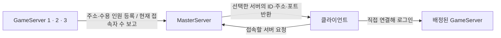

# 채팅 분산 서버

[포트폴리오로 돌아가기](README.md) · [원본 저장소](https://github.com/mjcjc/ServerCore)

같은 GameServer 실행 파일을 여러 포트에서 실행하고, **접속 배정은 MasterServer, 클라이언트 세션과 채팅은 GameServer, 채널 간 중계는 WorldServer**가 맡도록 구성했습니다.

[설계가 바뀐 지점](#design) · [접속 배정](#routing) · [채널 간 채팅](#world-chat) · [GameServer 내부 송신 큐](#queue)

## 여러 GameServer를 한 클러스터로 연결

처음에는 같은 GameServer를 서로 다른 ID와 포트로 실행했습니다. 각 프로세스가 독립적으로 로그인 세션과 채팅을 처리했고, 클라이언트는 접속할 서버 주소를 직접 사용했습니다. 이후 새 접속을 어디로 보낼지와 채널 사이에 메시지를 어떻게 전달할지 정하면서 다음과 같이 역할을 나눴습니다.

- **MasterServer**는 접속 후보의 주소, 수용 인원, 현재 접속자 수와 활성 상태를 관리합니다.
- **GameServer**는 배정받아 연결된 클라이언트의 로그인·세션·채팅을 처리합니다. 각 프로세스 안에서는 여러 소켓의 입출력 완료를 IOCP 워커들이 처리합니다.
- **WorldServer**는 같은 월드의 채널 서버를 등록하고, 채널 간에 공유할 채팅을 중계합니다.

## 새 접속을 배정하는 기준

GameServer는 기동 시 ID, 접속 주소, 수용 인원을 MasterServer에 등록하고 Heartbeat로 현재 접속자 수를 보냅니다. MasterServer는 상태 보고가 끊긴 서버를 비활성으로 표시해 새 접속 후보에서 제외합니다. 클라이언트가 배정을 요청하면 활성 서버 중 자리가 있고 현재 접속자가 가장 적은 서버의 주소를 돌려줍니다. 접속자 수가 같으면 서버 ID가 작은 곳을 선택합니다. 클라이언트는 받은 주소로 연결해 로그인합니다.

## 서로 다른 채널에 있는 플레이어에게 채팅 전달

각 GameServer는 자신의 월드와 채널 ID를 WorldServer에도 등록합니다. 채널을 넘어 공유할 메시지는 송신자의 GameServer에서 WorldServer로 보내고, WorldServer가 해당 채널 서버에 중계합니다. 수신 채널의 GameServer가 자신의 클라이언트 세션에 메시지를 보냅니다. 접속 배정 정보는 MasterServer가 관리하고, 실제 채팅 전달에는 GameServer와 WorldServer가 참여합니다.

[서버 등록 구조와 로컬 클러스터 실행 방법](https://github.com/mjcjc/ServerCore/blob/master/docs/multi-process-game-servers.md)

## 검증 범위

분산 구성에는 다중 GameServer 실행과 클러스터 테스트 스크립트를 마련했습니다. 원본 저장소에서 실행 결과로 제시하는 수치는 **로컬 3클라이언트 통신 검사에서 송신 100건·전체 수신 200건**입니다. 서버 배정, Heartbeat에 따른 비활성 처리, 월드 채팅은 구현 범위로 설명합니다. [원본 저장소와 검증 기록](https://github.com/mjcjc/ServerCore)

## GameServer 내부의 송신 큐

송신 큐의 64KB 한도에는 대기 중인 데이터와 전송 중인 데이터가 모두 들어갑니다. 전송 완료가 확인되면 해당 용량을 반환하고, 다음 전송에 보낼 데이터를 모읍니다. 자동 테스트 27개 항목에서 동시 입력, 종료 경합, 용량 경계 등을 확인했습니다. [송신 큐 구현](https://github.com/mjcjc/ServerCore/blob/main/TCPServer/SendQueue.cpp)

### 해결하려던 문제

비동기 전송에서는 큐에서 데이터를 꺼낸 뒤에도 완료 이벤트가 돌아올 때까지 해당 데이터를 관리해야 합니다. 예를 들어 64KB 한도 중 대부분을 사용한 데이터를 전송하기 시작했을 때, 꺼낸 순간에 용량을 반환하면 실제 전송이 끝나기 전에 다음 요청이 빈 용량으로 계산됩니다. 이 경우 큐의 숫자는 한도 이내여도 세션이 아직 처리 중인 데이터량은 그보다 커질 수 있습니다.

그래서 대기 중인 데이터와 전송 중인 데이터를 함께 세고, 완료 이벤트에서 용량을 반환하는 방식으로 설계했습니다. 새 데이터가 들어올 때 전송 중인지도 함께 확인합니다. 전송 흐름이 이미 있으면 큐에 보관하고, 진행 중인 흐름이 없으면 전송을 시작할 수 있도록 구분합니다. 전송이 끝나면 그동안 쌓인 작은 패킷을 다음 전송 단위로 묶을 수 있게 했습니다.

| 시점 | 송신 큐의 동작 |
|---|---|
| 보낼 데이터 추가 | 현재 전송 흐름이 없으면 전송을 시작할 수 있게 표시합니다. 진행 중이면 새 데이터를 대기열에 넣습니다. |
| 전송에 사용할 데이터 선택 | 대기 중인 작은 패킷은 최대 16KB를 기준으로 묶습니다. 첫 패킷이 기준 이상이면 분할하지 않고 단독으로 보냅니다. |
| 전송 완료 | 완료된 전송이 사용하던 용량을 반환하고, 대기 중인 데이터가 있으면 다음 전송으로 이어갑니다. |

### 송신 큐 테스트 결과

- **자동 테스트** · 27개 항목에서 동시 입력과 꺼내기, 종료 경합, 64KB 경계, 전송 중 용량 유지, 배치 동작을 확인했습니다.

[테스트 코드](https://github.com/mjcjc/ServerCore/blob/main/TCPServer/SendQueueTests.cpp) · [원본 실행 로그](https://github.com/mjcjc/ServerCore/blob/main/docs/evidence/sendqueue-tests.log)
